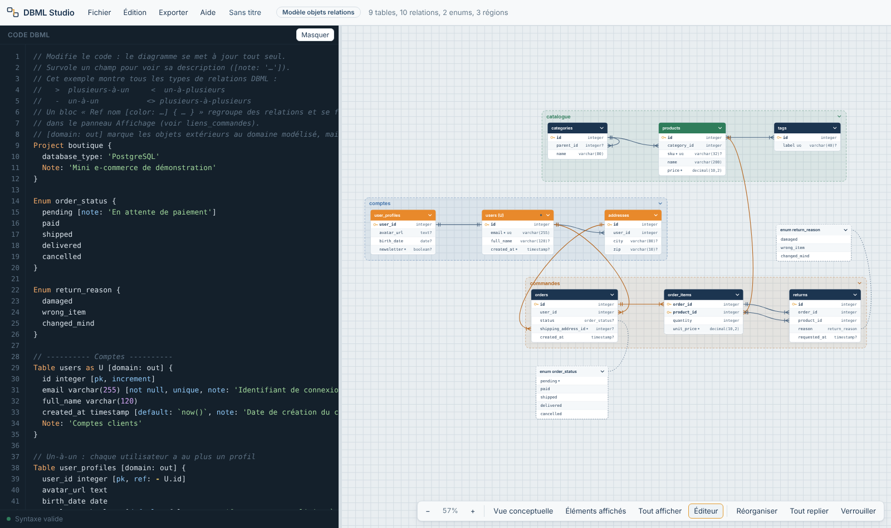
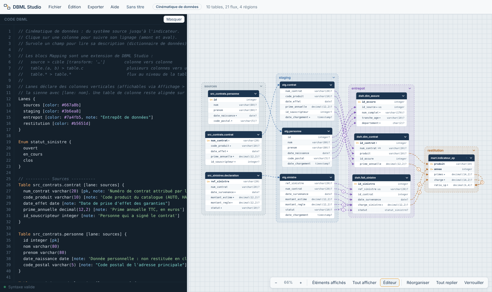

# DBML Studio

Éditeur et visualiseur de schémas de données [DBML](https://dbml.dbdiagram.io/), dans un seul fichier HTML. Aucune installation, aucun serveur, aucune donnée envoyée sur Internet : on ouvre le fichier dans un navigateur et on modélise.

**[Essayer en ligne](https://cyrilleelie.github.io/dbml-studio/)** · ou télécharger `index.html` et l'ouvrir hors ligne.

## Pourquoi cet outil

Les outils de modélisation du marché sont souvent lourds, en ligne, ou les deux. Dans un contexte où les modèles de données sont confidentiels, je voulais un outil qui tienne dans un fichier, fonctionne sans réseau, et serve aussi bien à dessiner un modèle métier qu'à documenter le lignage d'une donnée de la source jusqu'à l'indicateur.

## Ce qu'il fait

**Édition**
- Code DBML à gauche, diagramme à droite, mis à jour en direct.
- Coloration syntaxique, erreurs localisées à la ligne.
- Autocomplétion contextuelle : mots-clés, paramètres, déduction des clés étrangères à partir des noms de colonnes.

**Diagramme**
- Tables, enums et régions (`TableGroup`, imbricables) repliables.
- Placement automatique, avec un algorithme écrit pour l'outil.
- Vue conceptuelle : entités et cardinalités seulement, disposition organique qui limite les croisements.
- Multi-sélection, suppression en cascade (relations et appartenances aux régions nettoyées), verrouillage des positions.
- Descriptions des tables et des champs (`note`) affichées au survol : le schéma sert de dictionnaire de données.

**Deux types de fichiers**
- *Modèle objets relations* : tables, relations, cardinalités, objets du domaine.
- *Cinématique de données* : flux de la source à la restitution, avec lignage colonne par colonne.

**Extensions du langage DBML**
- `Mapping` : décrit les flux de données, colonne vers colonne, avec la transformation appliquée. Un clic sur une colonne affiche son lignage en amont et en aval.
- `Lanes` : colonnes verticales pour organiser une cinématique (sources, staging, entrepôt, restitution…).
- Groupes de relations nommés et colorés, filtrables.

**Fichiers et exports**
- Enregistrement dans un fichier `.dbml` ; la mise en page (positions, état replié) est conservée dans un commentaire du fichier, qui reste du DBML valide.
- Export PNG, JPG, WebP, SVG et SQL (PostgreSQL).

## Démarrer

1. Ouvrir `index.html` dans un navigateur récent (Chrome, Edge, Firefox).
2. Menu **Exemples** : « Boutique » pour un modèle relationnel, « Cinématique assurance » pour un flux de données.
3. Modifier le code : le diagramme suit.

## Comment il a été construit

DBML Studio a été développé en collaboration avec une IA (Claude), qui a écrit le code (parser DBML, interface, outillage de build). De mon côté : la conception fonctionnelle, les choix d'ergonomie, les extensions du langage, et les tests sur des cas réels, qui ont permis de corriger plusieurs bugs de comportement. C'est un exemple de la manière dont je travaille : partir d'un besoin métier, le spécifier, puis piloter la construction avec l'IA jusqu'à un outil utilisable au quotidien.

## Auteur

Cyrille Elie, Business Analyst et ingénieur IA. [cyrille-elie.com](https://cyrille-elie.com)

## Licence

MIT, voir [LICENSE](LICENSE).
